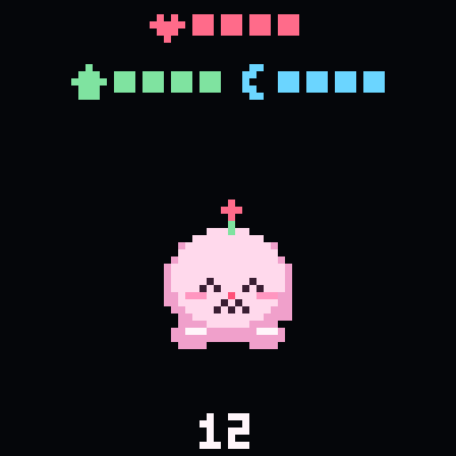
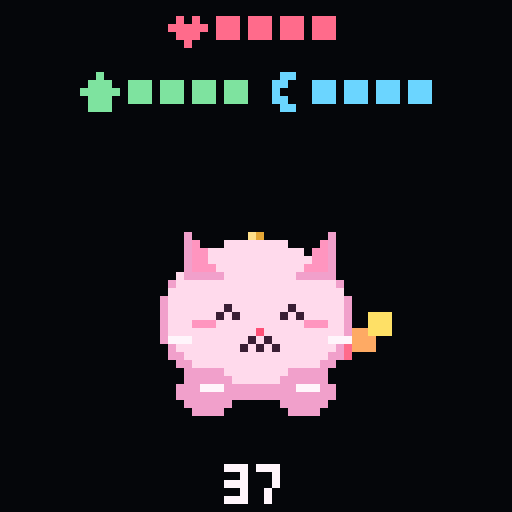
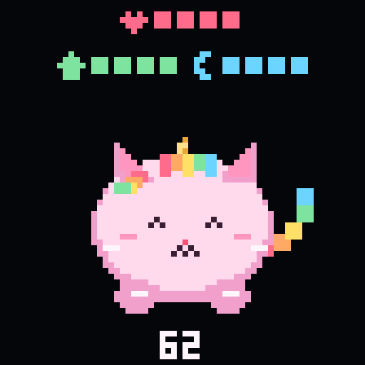
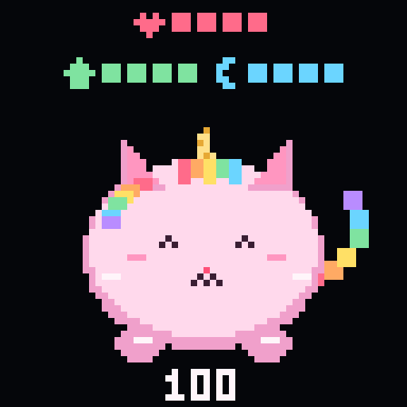
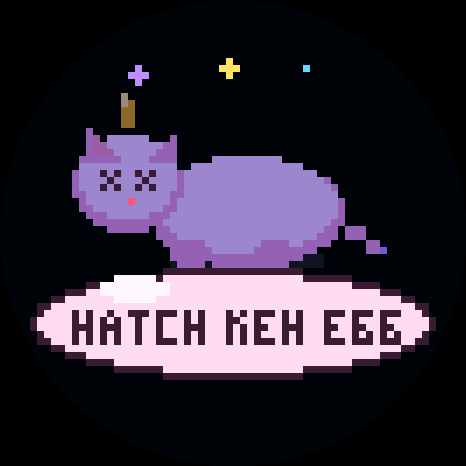

# Sprinkles — C core

Milestones 2 and 3 of `sprinkles-port-spec.md`, done and verified.

## Age

The number under her paws runs from 0 to 100. 100 stays. When that number goes up she plays Happy Birthday, about thirteen seconds.

Hold a finger still on the glass for a moment to mute. The word MUTE shows under the meters until you hold again.

Each year lasts:

| Age | Each year lasts |
|---|---|
| 0–24 | 20 minutes |
| 25–49 | 2 hours |
| 50–74 | 3 hours |
| 75–99 | 5 hours |
| 100 | stays |

She turns 25 after 8 hours 20 minutes, 50 after another 50 hours, 75 after another 75 hours, and 100 after another 125 hours.

The pictures are one year inside each band: 12, 37, 62, and 100. Her shape still changes when you feed her after she has been in the current form long enough, so the number does not pick the body.

### 0–24

20 minutes a year.

### 25–49

2 hours a year.

### 50–74

3 hours a year.

### 75–100

5 hours a year, then she stays at 100.

## Meters

Three bars sit above her. Each one has four pips.

### Heart

Happiness.

It falls when the cake bar is under 2, when there is poop on the floor, or while she is asleep. Sleep slows that drop. While she is awake, the cake bar is at 2 or more, and the floor is clean, a pip comes back about every 15 minutes. Petting her can add one, at most once every 10 seconds, until the bar is full. Left in a bad state, one pip takes about 3 hours 10 minutes to fall off.

Feeding her when the cake bar is already full still works, and that cake costs one heart. At 0 she dies.

### Cake

How full she is.

It empties on its own. The first pip takes about 5 minutes, then the rest slow down, and an empty bar takes about 6 hours. Tap the cake meter to feed her. The bar does not have to have room. A cake on a full bar costs a heart.

### Moon

Energy.

It falls while she is awake, about one pip every 8 minutes. A full bar lasts about half an hour, and at empty she falls asleep until a pip comes back. When the screen goes dark she goes to sleep, and the bar fills, about one pip every 3 minutes, until you tap the glass.

## When she dies

The heart bar at 0 is the end, from one cake too many or from being left. She lies still, and a button underneath reads HATCH / NEW EGG. Tap it and she starts over as an egg.

## What's here

    sprinkles/gfx.[ch]        64x64 pixel world + primitives
    sprinkles/pet.[ch]        state machine, no hardware
    sprinkles/sprites.[ch]    the unicorn cat and every prop
    sprinkles/app.[ch]        interaction layer: animation scheduling,
                              triggers, menu, touch, frame composition
    sprinkles/board.h         the ONLY hardware interface
    sprinkles/board_esp32.c   its ESP-IDF implementation (TODO(bsp) holes)
    host/board_host.c         a board that isn't there, for testing
    host/test_pet.c           42 checks on the state machine
    host/test_app.c           86 checks on the interaction layer
    host/host_golden.c        renders reference scenes to PPM
    host/diff.py              pixel-diffs them against golden-frames/
    main/main.c               the loop

`BRINGUP.md` has the ordered checklist for the hardware holes.

## Verify before you flash

Put `golden-frames/` next to this directory, then:

    make

- `make test` — 42 checks on the state machine
- `make test-app` — 86 checks on the interaction layer
- `make golden` — renders 28 scenes and diffs them against the reference
  frames **pixel for pixel**. Exit code is non-zero on any difference, and it
  writes `diff.png` (gold | ours | diff) for anything that fails.

All 28 currently match exactly. If you touch `gfx.c` or `sprites.c` and this
goes red, you have introduced a rounding bug — `diff.png` will show you where.

## On device — three ways, same sources

The `.c` files under `sprinkles/` are shared by all three. There is no fork.

### PlatformIO (recommended)

Install the "PlatformIO IDE" extension in VS Code, open this folder, Build.
It installs its own toolchain into the project and has none of the ESP-IDF
extension's self-repair behaviour.

    pio run -t upload
    pio device monitor

### Arduino IDE

The sketch you flash is already in the repo:

    arduino/Sprinkles/Sprinkles.ino

That folder has the `.ino`, the board code, `pin_config.h` for the Waveshare
ESP32-S3-Touch-AMOLED-1.75, and the scene code. Open it and Upload. You do
not copy pins in from the Waveshare examples, and you do not run a generator
before the first flash.

Board: **ESP32S3 Dev Module**. Settings that matter:

| Setting | Value |
|---|---|
| Flash Size | 16MB (128Mb) |
| PSRAM | **OPI PSRAM** — required, the frame buffer needs it |
| Partition Scheme | 16M Flash (3MB APP/9.9MB FATFS), or another 16MB scheme |
| USB CDC On Boot | Enabled, so `Serial` works |

Install these three from Library Manager. Search for the name in the first column.

| Library Manager name | What it is for |
|---|---|
| GFX Library for Arduino | The round display |
| SensorLib | Touch and the clock |
| XPowersLib | The battery chip |

Wire, Preferences, WiFi, and the I2S speaker class come with the ESP32 board package. The ES8311 speaker driver is already in the sketch folder.

Uploading does not wipe the pet stored on the board, which is why a fresh flash was still the old one. This download uses a new save, so that pet is skipped and she starts as an egg. Turning her off after that keeps the new one.

`python3 tools/make_arduino.py` rewrites `arduino/Sprinkles/` from
`sprinkles/` and `arduino_src/` after you edit those. The sketch folder is
what a download should open.

### ESP-IDF

    idf.py set-target esp32s3
    idf.py add-dependency "waveshare/esp32_s3_touch_amoled_1_75"
    idf.py build flash monitor

## Animations

All ported and verified: idle, nap, sad, eat, love, petting, dance, the front
flip, peekaboo and the five-beat transformation. **All 28 reference frames
match pixel for pixel.**

The flip renders her flat into `gfx_alt`, then `gfx_rot_blit()` maps each
destination pixel centre back through the inverse rotation and floors it —
which is what canvas does with smoothing off. 4096 samples per frame.

## Architecture

    main.c        the loop: input, tick, draw, persist
      |
    app.c         WHEN things happen - animation scheduling, cooldowns,
      |           triggers, menu rules, touch routing
    pet.c         WHAT she is - needs, stages, moods
    sprites.c     WHAT she looks like
    gfx.c         pixels
      |
    board.h       the only hardware interface

Nothing above `board.h` includes an `esp_*` header. If something does, it has
leaked, and the host tests will stop building — which is the point.

`app_tick` draws all four of its random values up front rather than inside
branches, so behaviour doesn't depend on control flow. That was not
aesthetics: with a variable number of draws per tick, the trigger conditions
were untestable.

## Hardware status

All implemented in `arduino_src/board_arduino.cpp`:

| Peripheral | How |
|---|---|
| Display | Arduino_GFX, `Arduino_ESP32QSPI` + `Arduino_CO5300` |
| Touch | SensorLib `TouchDrvCST92xx`, mirrored X and Y |
| Audio | `ESP_I2S` + Espressif's ES8311 driver (vendored), PA on GPIO46 |
| RTC | SensorLib `RtcDrv` / PCF85063, seeded from `__DATE__` if never set |
| IMU | SensorLib `SensorQMI8658`, pickup by acceleration delta |
| BOOT button | GPIO0, active low |
| PWR button | TCA9554 P4 at 0x20, **active high** |
| Sleep | light sleep, wake on touch/BOOT, 2 s poll for pickup |
| Persistence | Preferences (NVS) |
| Battery | AXP2101 via XPowersLib. Charging on: temperature pin off, 200 mA, 4.2 V. USB turns the board on. From the battery alone, a short press of the upper PWR button turns it on. Holding that button about 6 seconds turns the board off. |
| Grown-up screen | both buttons held 5 s, native-resolution text |

The three Library Manager installs are listed under Arduino IDE.
`pin_config.h` is already in `arduino/Sprinkles/`.

`board_esp32.c` is the ESP-IDF variant and still has its `TODO(bsp)` holes —
the Arduino path is the maintained one.

## Three bugs the golden test caught

Worth reading before you touch the drawing code, because all three are the
kind that ship as "looks slightly off" and are miserable to find later.

1. **Ear geometry** — three transcription errors in one block (0.62 vs 0.55,
   wrong vertical anchor, height vs height+2). The blob matched perfectly and
   every eared stage failed, which pointed straight at it.
2. **Ray sampling** — the reference starts its radius loop at a *fractional*
   value and steps by 1. Truncating to int first shifts every sample along the
   spoke. Cost: 21 pixels in one transformation frame.
3. **Per-pixel truncation** — the reference truncates each plotted coordinate
   with `x|0`, not the sprite's origin. For negative coordinates those differ,
   because truncation is toward zero rather than floor. This only shows up
   when an effect drifts off the left edge, and it was worth exactly one pixel
   in one frame. `gfx_map*` therefore take `double` origins on purpose — do
   not "tidy" them to int.
